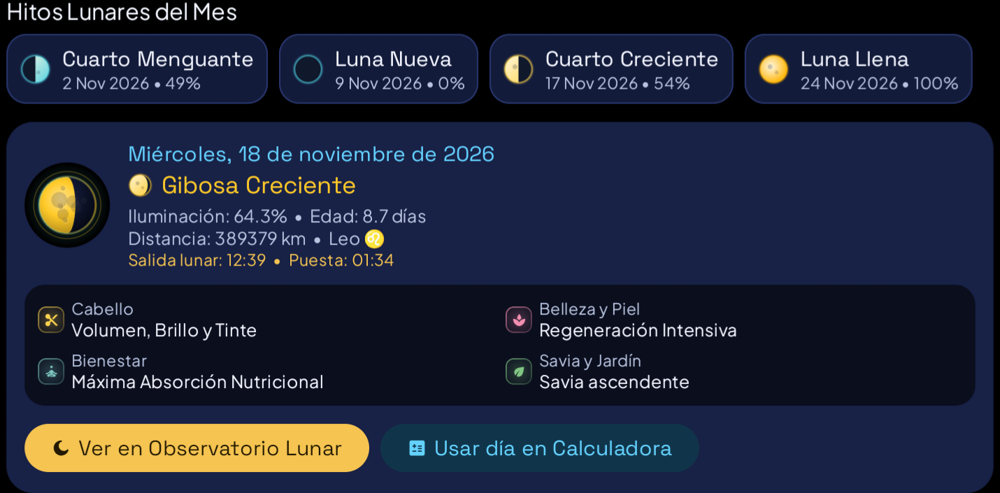

# TodUno

**Calendario lunar · Observatorio astronómico · Reloj mundial · Calculadora científica**

Aplicación Android que reúne cuatro herramientas en una sola interfaz, con funciones principales sin conexión y sin necesidad de crear una cuenta.

[](https://github.com/latanvillegas/TodUno/actions/workflows/android-release.yml)

**[Descargar versión estable v0.0.1](https://github.com/latanvillegas/TodUno/releases/tag/v0.0.1)** · [APK oficial](https://github.com/latanvillegas/TodUno/releases/download/v0.0.1/TodUno-release.apk) · [Política de privacidad](docs/PRIVACY_POLICY.md) · [Seguridad](SECURITY.md) · [Reportar un problema funcional](https://github.com/latanvillegas/TodUno/issues)

## Funcionalidades

| Módulo | Funcionalidades |
| --- | --- |
| Calendario lunar | Fases y eventos lunares, navegación por meses, notas personales y recordatorios. |
| Observatorio | Iluminación, edad y distancia lunar, datos orbitales, próximas fases y eclipses, con orientación por hemisferio. |
| Relojes y tiempo | Hora local y mundial, husos horarios personalizables, tiempo astronómico, cronómetro con vueltas y temporizador. |
| Calculadora científica | Trigonometría en grados y radianes, funciones inversas, logaritmos, potencias, raíces, memoria de respuesta e historial local. |



## Descargar e instalar

- **Requisito mínimo:** Android 7.0 (API 24).
- **Versión estable actual:** `0.0.1` (`versionCode` interno `20001`).
- **Distribución oficial:** [GitHub Releases](https://github.com/latanvillegas/TodUno/releases/latest). Descarga únicamente `TodUno-release.apk` de la publicación oficial; el archivo `.aab` está destinado a distribución mediante tiendas y no a instalación directa.
- En Android, abre el APK desde Descargas y concede el permiso de instalación desde esa fuente si el sistema lo solicita. Revisa que el origen sea el repositorio oficial antes de instalar.

### Comprobar la integridad del lanzamiento

En Termux o un sistema con GitHub CLI y `sha256sum`, descarga **los tres archivos** de la misma publicación y verifica sus checksums:

```bash
mkdir -p toduno-verify
gh release download v0.0.1 \
  -R latanvillegas/TodUno \
  --dir toduno-verify
cd toduno-verify
sha256sum -c SHA256SUMS
```

El resultado esperado es `OK` para ambos binarios. Una suma de comprobación detecta alteraciones o descargas corruptas, pero **no sustituye** la verificación de la procedencia del repositorio ni de la firma del APK. El pipeline de lanzamiento verifica automáticamente la identidad del paquete, la firma, el certificado esperado y la alineación del archivo antes de publicarlo.

### Compatibilidad con instalaciones anteriores

La versión `v0.0.1` inicia una línea con una **identidad de firma diferente** de los APK históricos `v1.x`. Android no permite actualizar directamente entre esas dos firmas:

1. En la instalación antigua, exporta tus datos a JSON y guarda ese archivo fuera del almacenamiento privado de la aplicación.
2. Comprueba que dispones de una copia de seguridad accesible.
3. Desinstala la versión antigua, instala el APK oficial `v0.0.1` y restaura el JSON.

Si ya utilizabas el **candidato de prueba firmado con la misma identidad** que `v0.0.1`, Android puede actualizarlo sin desinstalar porque el `versionCode` oficial es superior. La versión visible y el código interno son campos diferentes.

**Protege los respaldos JSON:** pueden contener notas, preferencias u otros datos personales. No los adjuntes a incidencias públicas.

## Tecnología y arquitectura

- **Plataforma:** Android nativo; Kotlin, Jetpack Compose y Material 3.
- **Estado y ciclo de vida:** ViewModel, Kotlin Coroutines y componentes AndroidX Lifecycle.
- **Datos locales:** Room para persistencia estructurada y DataStore para preferencias.
- **Componentes del sistema:** notificaciones, receptores para reprogramar recordatorios y widget lunar.
- **Build:** Gradle Wrapper, Android Gradle Plugin, KSP y catálogo de versiones de Gradle.

Estructura principal del proyecto:

```text
app/src/main/                 Aplicación Android
app/src/main/java/com/example/data/           Persistencia
app/src/main/java/com/example/domain/         Lógica de dominio
app/src/main/java/com/example/ui/             Interfaz Compose
app/src/main/java/com/example/notifications/  Alarmas y avisos
app/src/main/java/com/example/widget/         Widget de Android
app/src/test/                 Pruebas automatizadas
.github/workflows/            Integración continua y publicación
scripts/                      Verificación de artefactos
docs/                         Privacidad y proceso de lanzamiento
fastlane/metadata/android/    Textos e imágenes para catálogos
```

## Desarrollo y comprobaciones

Entorno de referencia del pipeline: **JDK 21**, Android SDK **36.1** (con compatibilidad de instalación de plataforma 36) y Build Tools **36.0.0**. Android Studio o un entorno de desarrollo con Android SDK pueden utilizar el Gradle Wrapper del repositorio.

```bash
git clone https://github.com/latanvillegas/TodUno.git
cd TodUno
cp .env.example .env
chmod +x ./gradlew
./gradlew :app:testDebugUnitTest :app:lintDebug --no-daemon
```

El archivo `.env.example` no contiene credenciales; las funciones principales actuales no requieren claves de API. El proyecto usa una configuración de firma **distinta** para los artefactos de producción. No se incluyen materiales privados de firma en el código fuente. Para revisar un lanzamiento, utiliza los binarios oficiales y sus comprobaciones de integridad.

## Cadena de publicación y seguridad

El flujo [Android quality and signed release](.github/workflows/android-release.yml) aplica estos controles:

1. En cada PR y push a `main`, ejecuta pruebas unitarias y Android Lint sin necesitar secretos de publicación.
2. Una ejecución manual sobre `main` genera un candidato firmado para evaluación, **sin crear un GitHub Release**.
3. Una etiqueta de publicación autorizada sobre un commit de `main` activa la compilación del APK y del AAB.
4. El trabajo de publicación exige los secretos de firma de GitHub Actions; **no genera claves nuevas como alternativa** si faltan.
5. Se comprueban el identificador de aplicación, versión, certificado de firma esperado, firma APK, alineación de 16 KB, firma AAB y checksums SHA-256 antes de adjuntar artefactos al release.

**Modelo de gestión de secretos:** la clave privada de firma se conserva bajo custodia del responsable del proyecto, con respaldo cifrado y acceso restringido. Los valores secretos se suministran al pipeline por GitHub Actions; **nunca** deben aparecer en `README.md`, commits, ejemplos, incidencias, solicitudes de cambio, logs, capturas o artefactos descargables. Los nombres de variables y las huellas públicas de certificados no son claves privadas, pero tampoco se necesita publicar valores sensibles para documentar el proceso. `.gitignore` es una barrera contra errores accidentales, **no** un mecanismo de protección suficiente por sí solo.

Para incidentes o hallazgos de seguridad, consulta [SECURITY.md](SECURITY.md). No publiques pruebas de concepto, tokens, contraseñas, almacenes de claves ni datos privados de usuarios en Issues públicos.

## Privacidad y tratamiento de datos

Las notas y el historial se gestionan localmente; las funciones principales no requieren cuenta ni conexión. El manifiesto fuente no solicita el permiso `INTERNET`. La app permite exportar/restaurar datos con el selector de archivos de Android y solicita permisos de notificación cuando corresponde. **Android puede incluir datos de la aplicación en sus copias de seguridad del sistema**, según la configuración del dispositivo; no debe confundirse con una sincronización propia de TodUno.

Consulta la [política de privacidad](docs/PRIVACY_POLICY.md) para el detalle de permisos, datos locales y copias de seguridad.

## Documentación, soporte y licencia

- [Versión estable y descargas](https://github.com/latanvillegas/TodUno/releases/latest)
- [Historial de publicaciones](https://github.com/latanvillegas/TodUno/releases)
- [Procedimiento técnico de lanzamiento](docs/RELEASE_CHECKLIST.md)
- [Ficha de tienda](docs/STORE_LISTING.md)
- [Política de seguridad y divulgación responsable](SECURITY.md)
- [Política de privacidad](docs/PRIVACY_POLICY.md)
- [Incidencias funcionales y propuestas](https://github.com/latanvillegas/TodUno/issues)

**Licencia:** este repositorio no contiene actualmente un archivo `LICENSE`. Que el código sea visible públicamente **no implica** una licencia de reutilización, redistribución o modificación. La incorporación de una licencia requiere una decisión explícita del titular.
